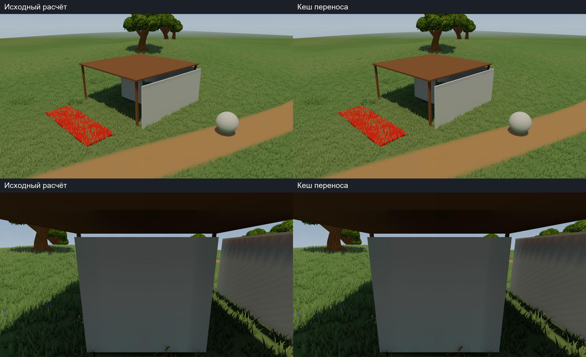
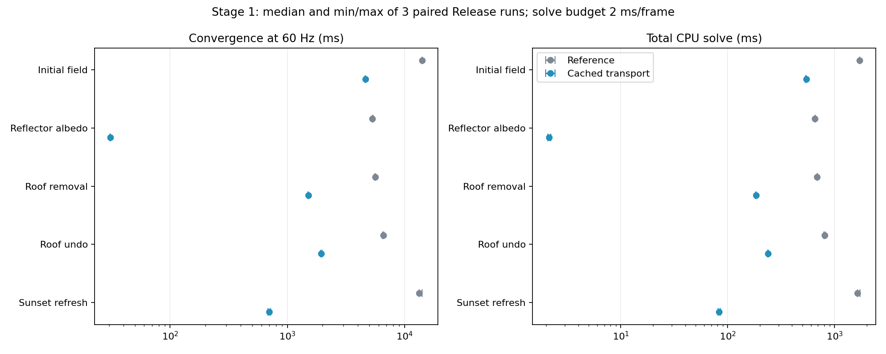

# GI cache Stage 1 — measured transport reuse

Parent checkpoint: `100c1745924493d2d8be0f29b5541c695273ed6e`.
This packet preserves the first cache optimization on the unchanged Meadow GI
fixture. Game Assets, Packages and ProjectSettings remain outside this delta.

- [Report, methods, limits and raw results](../../reports/lighting-gi-cache-stage1-20261026-ru.md)
- [Updated next-stage plan](../../plans/lighting-next-stages-20261026-ru.md)
- [Handoff](../../handoffs/lighting-to-map-authoring-20261025-ru.md)
- [Source SHA/GUID manifest](stage1-manifest.json)
- [Before/after C# patch](gi-100c174-to-stage1.patch)
- [Raw summary](evidence/stage1-summary.json)

Median albedo convergence 5.33 s -> 31 ms; roof removal 5.62 -> 1.52 s;
roof undo 6.59 -> 1.95 s; light refresh about 13 -> 0.65-0.70 s. Solve budget stays
2 ms. Saved transport payload is about 8.38 MiB plus managed overhead.
193 Edit Mode and 6 Play Mode passed. 24 full-field comparisons of 21,609
probes have maximum absolute coefficient error 5.0664e-7. First pair contains
27 actual reference/cached image pairs. Allocations are diagnosed separately
in a Development Player with a positive GC.Alloc control; Release counters
that failed calibration are explicitly unsupported.

`payload/` contains only three changed research runtime sources and five new
sources, with their GUIDs. Apply as a delta to the existing lighting workspace
and licensed Meadow dependencies, not as a fresh-clone runnable Unity project.
The shared shaders, original scene/materials, reference queue/builder and root
settings are preserved. Source before-images are frozen in `reference/`.

This remains a serial fixed AABB/L1 experiment with flat proxy ground. Roof
updates still take over a second. No production activation, new map editor
migration, canopy, continuous-time injection or temporal blending is claimed.
Next work profiles remaining primary/shadow kernels and prioritizes visible
probes before terrain/object integration. The editor can continue independently.

Raw PNG/bin sets, standalone Players and full logs remain local; SHA-256 and
compiled Player hashes are recorded in evidence-index.json. No third-party
binary source models/textures or large generated probe dumps are uploaded.
