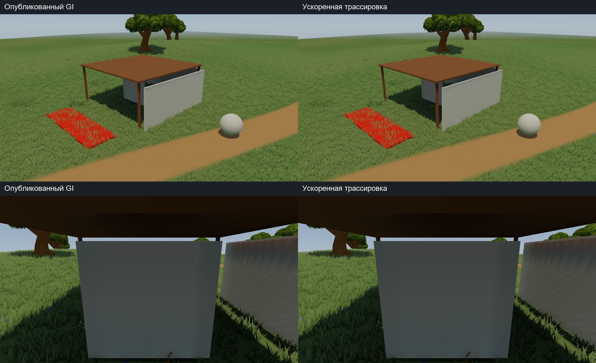
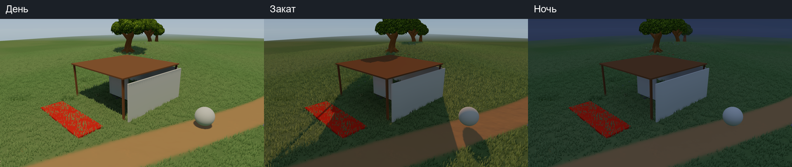
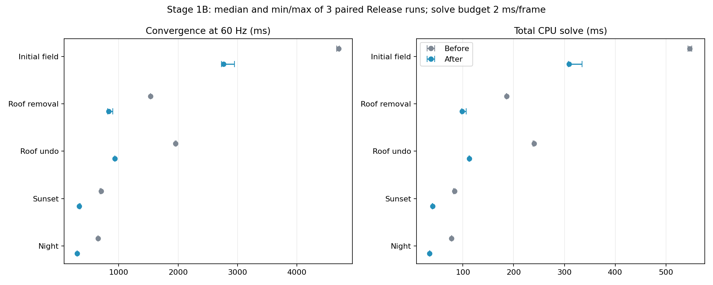

# GI Stage 1B — faster exact candidate/visibility kernels

Delta over `98da06954c1d8c027d275ea80f8300c8b65ff7e9`; the existing Stage1
transport packet and licensed Meadow dependencies are required. Root game Assets,
Packages and ProjectSettings are unchanged. This is an integration packet, not
an automatic production-GI activation or a fresh-clone runnable game.

- [Russian report and measured limits](../../reports/lighting-gi-kernels-stage1b-20261026-ru.md)
- [Next steps, including ready-model visual fixture](../../plans/lighting-next-stages-20261026-ru.md)
- [Map-authoring handoff](../../handoffs/lighting-to-map-authoring-20261025-ru.md)
- [Source hashes](stage1b-manifest.json), [audit](stage1b-audit.json), [patch](gi-98da069-to-stage1b.patch)
- [Raw summary](evidence/stage1b-summary.json), [local binary/capture/log hashes](evidence-index.json)

Three paired Release runs: median initial convergence 4.701 -> 2.765 s,
roof removal 1.532 -> 0.831 s, undo 1.955 -> 0.934 s, light refresh about
0.65-0.70 -> 0.30-0.34 s. Solve budget remains 2 ms, same rays and workload.
197 Edit Mode and 6 Play Mode tests passed. All 24 full probe fields are
bit-identical to the published cached Stage1 Player; serial reference error
is at most 5.0664e-7. Actual PNGs have ordinary SSAO noise.

Candidate slabs reject disjoint axes early. Any-hit stops visibility at the
first blocker. Exactly zero sun/moon sources skip visibility with a correctly
invalidated zero-to-nonzero epoch. The original 72 sky directions/inverses are
precomputed without sampling changes. Independent serial reference is retained.
Four C# files and their existing GUIDs are in payload; before-images in reference.
Shared shaders, original fixture, palette and volume/queue/review are unchanged.

Remaining limits: fixed L1 field, flat ground and six AABB proxies, no canopy,
real terrain, local emitters, continuous-time blending or visible priority.
Geometry still takes 0.83-0.93 s. Next: visible-priority queue plus a standard
small-edit latency case, then versioned continuous lighting and current terrain.
Ready models will have a separate visual zone; the cube/walls/roof experiment
stays available. No new production model was added to this performance A/B.

Raw full-size PNG/bin sets and compiled Players remain local with hashes.
Release allocation bytes remain unsupported; previous Stage1 Development
allocation evidence is not claimed as a new Player-wide zero-GC measurement.
