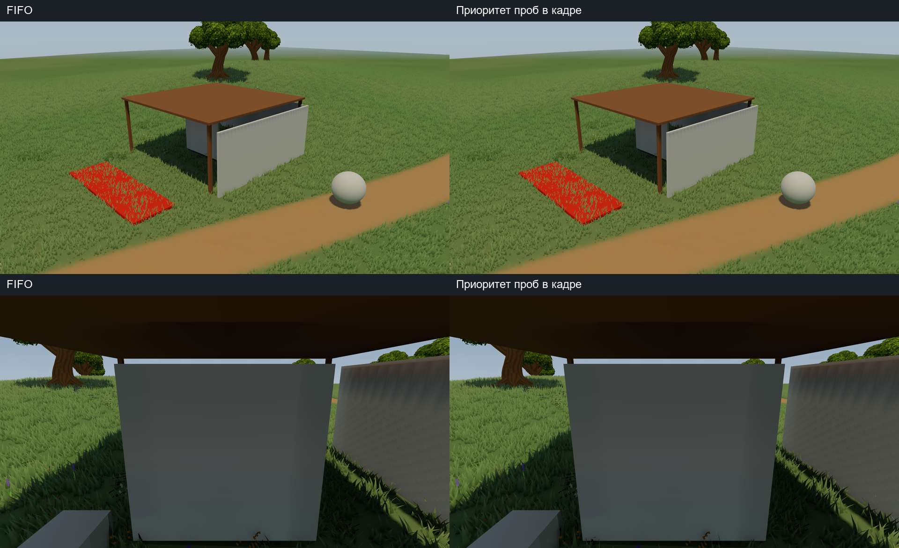
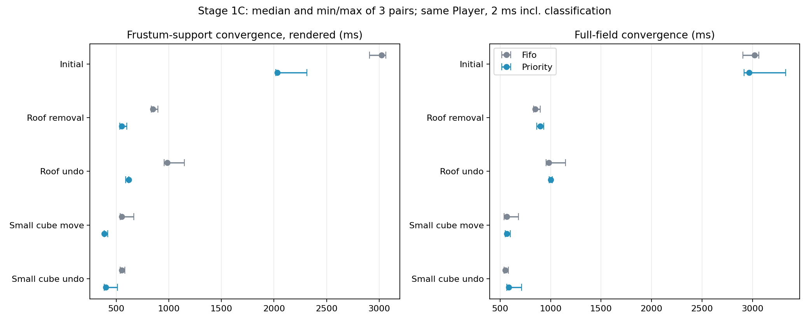

# GI Stage 1C — frustum-support priority with bounded background progress

Delta over `d1d92e0505110726be62f6ed408f33e446201ce8`. Existing Stage1/1B packets
and licensed Meadow dependencies are required. Root game Assets, Packages and
ProjectSettings are unchanged. No production GI activation or map-tool migration.

- [Report: definitions, measured results and limits](../../reports/lighting-gi-priority-stage1c-20261026-ru.md)
- [Next-stage plan](../../plans/lighting-next-stages-20261026-ru.md)
- [Map-authoring handoff](../../handoffs/lighting-to-map-authoring-20261025-ru.md)
- [Source/GUID hashes](stage1c-manifest.json), [audit](stage1c-audit.json), [patch](gi-d1d92e0-to-stage1c.patch)
- [Raw summary](evidence/stage1c-summary.json), [local artifacts/Player SHA index](evidence-index.json)

Three preferred requests are followed by one global FIFO request. Intrusive lists
avoid stale/duplicate queue entries. Camera reclassification retains fairness and
is limited to once per four frames; its cost is inside the same cooperative 2 ms
budget. Camera queue preference may lag three frames; geometry correctness does not.
Priority is conservative frustum support, including interpolation neighbours,
not depth-based pixel visibility. Keep this distinction when reading latency.

203 Edit Mode and 6 Play Mode tests passed. Final Guarded Release evidence has
three FIFO/Priority pairs on one Player, a serial reference run and a separate
moving-camera progress check. 36 complete probe fields compare exactly between
FIFO and Priority; serial error <=5.0664e-7. The first eight scenarios also match
the published Stage1B fields exactly. Raw metrics and min/max are in the report.

The optional automated small-edit case adds a 0.8 m diagnostic cube, commits a
0.5 m move, undoes it and removes it, using the existing shared neutral material.
The original cube/walls/roof experiment remains. Ready production models have a
separate planned visual zone; no new production models were added in this pass.

Four existing C# files and one new test source plus existing/new GUID metadata
are in payload; before-images in reference. Trace/transport kernels, all shared
shaders, original saved scene/materials and root settings stay fixed. Changed
buffer probes are still published in place: temporal age boundaries are possible.
Next work is versioned/paced publication and continuous-time lighting, followed
by current terrain/object snapshots and the ready-model visual fixture.

Limits remain fixed L1 field, flat proxy ground, max eight AABBs, no canopy or
local emitters. Queue memory grows about 281 KB; full work does not disappear.
Support rendering metrics are not pixel-change or input-to-display latency.
Whole-Player allocations/OS/VRAM peak are not newly measured. Large PNG/bin sets,
Players and logs remain local with hashes. Earlier Final* pilot evidence is
excluded; Guarded* and final XML/build are authoritative.
