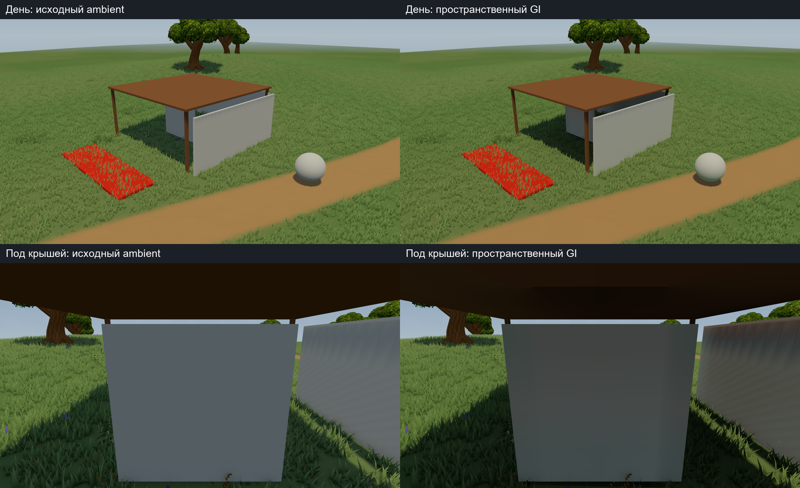
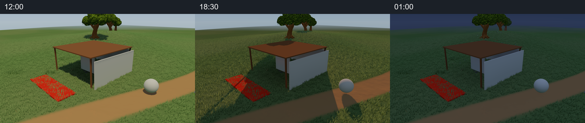
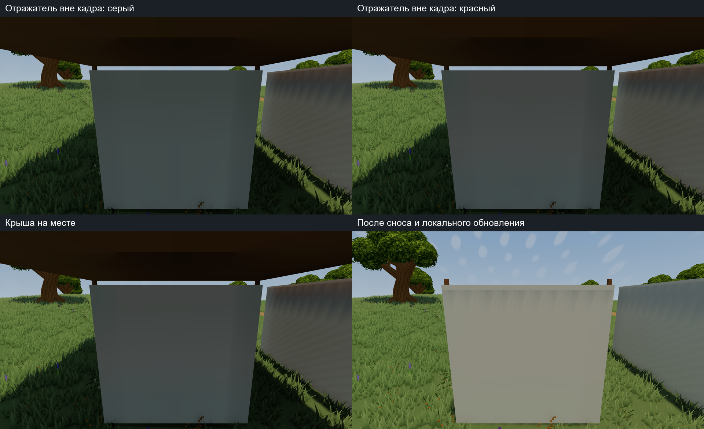

# Spatial indirect lighting checkpoint — 26 October 2026

This commit publishes the complete frozen 82-file GI experiment packet, real
Player contact sheets, raw validation and measurements, and the next-stage plan.
It builds on Meadow checkpoint `9e8c126abd2bf34a15df3bcbf01f7285cfe90843`.
Unity source paths are under `packet/payload/` for reviewable integration;
this publication does not activate GI or migrate the live game project.

- [Next stages and acceptance criteria](../../plans/lighting-next-stages-20261026-ru.md)
- [Current handoff](../../handoffs/lighting-to-map-authoring-20261025-ru.md)
- [Experiment report](packet/docs/reports/spatial-indirect-prototype-20261026-ru.md)
- [Source/GUID manifest](packet/docs/lighting-integration/spatial-indirect-manifest.json)
- [Function-scoped shader patch](packet/docs/lighting-integration/meadow-baseline-to-spatial-indirect.patch)
- [CPU update latency](packet/evidence/FinalPrecision/updates.json)
- [Ordinary-frame GPU/CPU timings](packet/evidence/FinalPrecision/benchmarks.json)

186 Edit Mode and 6 Play Mode tests passed. The bounded field demonstrates sky
occlusion, one diffuse bounce, an offscreen contributor, local invalidation,
revision rejection and deterministic undo. The final build had no errors/warnings.
GPU mean was 0.840 / 1.184 ms off/on at 1920x1080 on RTX 4070 Ti SUPER with Linear,
HDR, MSAA4 and SSAO. Local updates still take 5-7 seconds at the chosen CPU budget.
The prototype has six proxy boxes, approximate flat ground, a fixed L1 probe
field, no production map adapter and no continuous-time injection strategy.
It is not production GI or a reproduction of the complete Tiny Glade renderer.

The first planned implementation profiles and accelerates geometry transport and
lighting injection on the unchanged fixture. Later stages cover smooth updates,
current terrain/object snapshots, artistic lighting and scalable integration.

The original ZIP is preserved byte-for-byte as expanded files under `packet/`.
Its README and reference handoff retain the historical local-only status at
packaging time; this outer README and current handoff describe this publication.
`publication-manifest.json` maps every published input to SHA-256 and Git blob SHA.
The three PNGs are labelled contact sheets of actual game frames; no generated
or repainted images are used. Complete capture sets and standalone Players remain
at the local Research path. Third-party binary model/texture sources are not
included: restore licensed dependencies using the frozen GUID/hash manifests.
Do not copy old map-tool snapshots over the independently evolving editor;
merge shader changes by function and preserve wind/masks/LOD/depth/shadow/normals.
