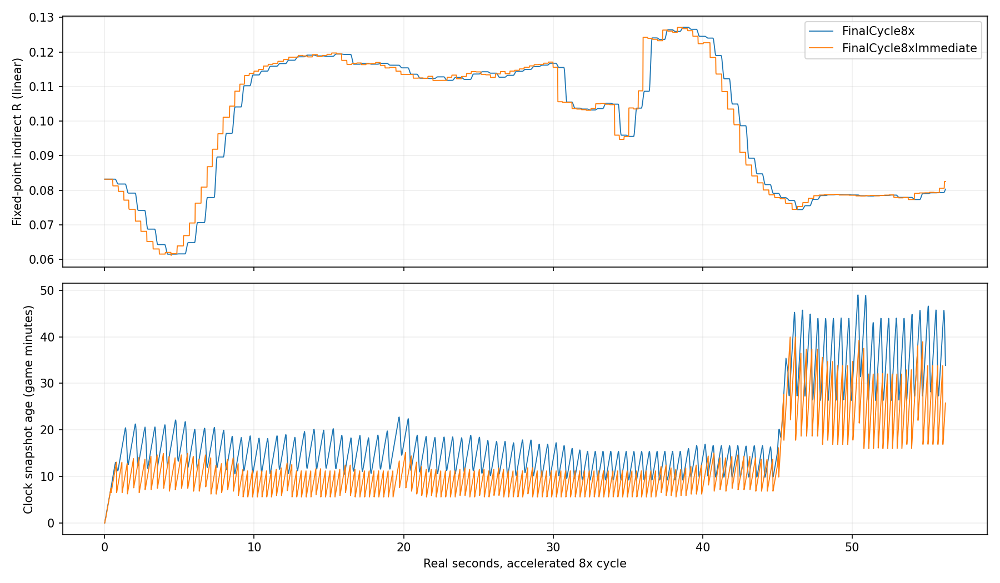
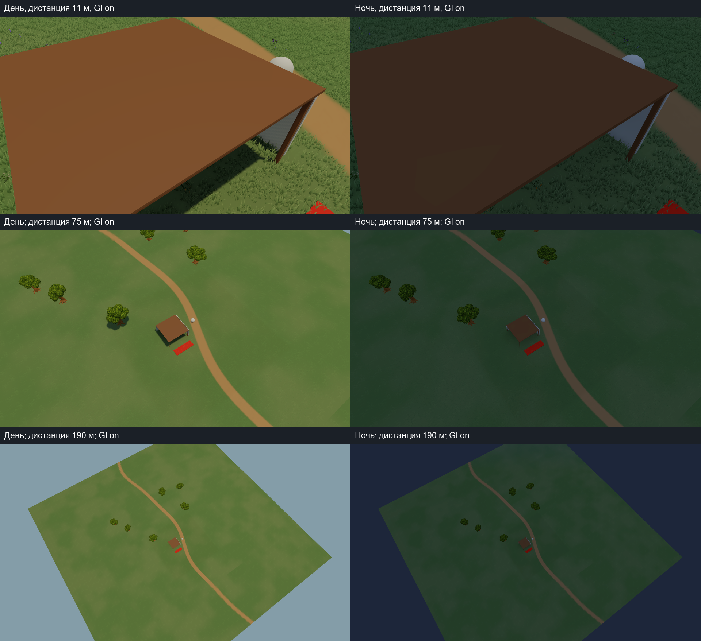
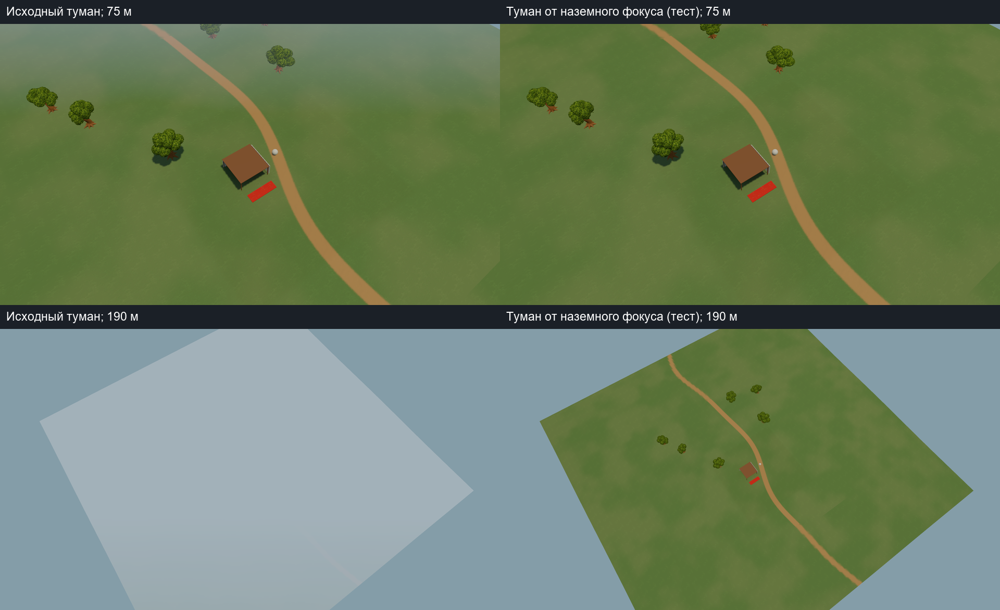
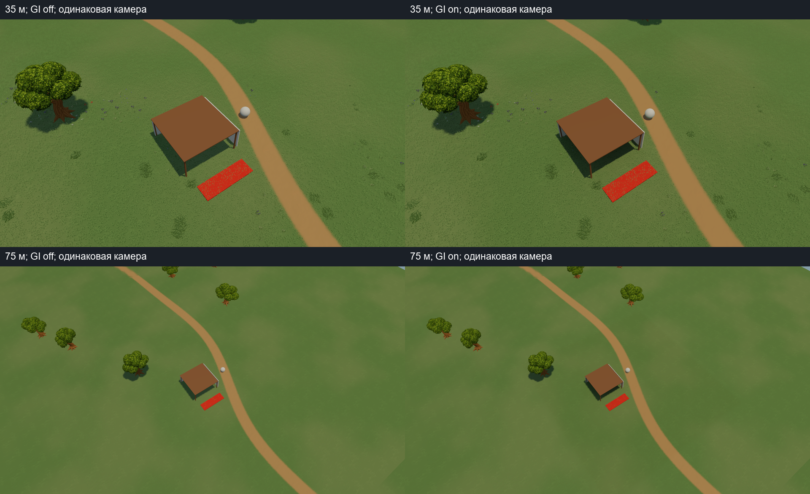

# Согласованные версии GI, плавные сутки и камера стратегии — этап2А

Дата фиксации: 27.10.2026. Исследовательский delta поверх опубликованного
`f4ae7b19e70bcd9a53f8ce7eea84d97ef195d542`. Основная игра и редактор карты
автоматически не переключаются. Tiny Glade остаётся художественным ориентиром;
этот этап не объявляет совпадение качества или реализацию его закрытого renderer.

## Результат и приоритет камеры

В экспериментальном Player вычисляемое поле отделено от опубликованного.
Целая согласованная версия появляется после окончания очереди и плавно сменяет
предыдущую за0.2s по smoothstep. Свет/небо/тени продолжают получать время из
единого WorldTimeSystem. GI не управляет временем, ночью матч не останавливается.
Проверены полные непрерывные сутки1x и ускоренные8x.

Уточнение пользователя: основной вид стратегии сверху, часто с большой высоты,
с родными ненулевыми LOD; максимальное качество нужно при приближении. Поэтому
крыша/тонкая стена остаются диагностикой утечек. Следующий художественный бюджет
направляется на читаемость поселения/силуэтов/крон и стабильность при zoom/pan.
Декоративная зона готовых моделей будет отдельной; куб, стены и крыша сохраняются.

## Изменения и границы

- SpatialIndirectPublication: CPU current/previous, revision gate, общий переход.
  Новая версия ждёт завершения старого fade, промежуточное состояние не rebased.
- Geometry commit немедленно запрещает старый transport в обоих display histories
  в отдельных old/new Bounds с halo2R+0.52m. Known-invalid не заменяется sky fallback.
  Preview не меняет кеш; быстрые undo/move/restore не возвращают устаревший свет.
- SpatialIndirectVolume: два GPU buffers, coalescing текущего времени пока очередь
  занята, отдельные solve/publish/upload показатели. Только общий GI include
  LC_SpatialIndirect.hlsl читает предыдущую версию; при alpha1 чтение обходится.
- Новый temporal harness и7 unit tests; отдельный camera harness включает настоящий
  StrategyCameraController, ввод выключен, test-only reflection задаёт его targets.
  FOV50, distance11/35/75/115/190m, pitch42/50/57/62/68°, день/закат/ночь.
- Семь shared shader families, Trace/Transport/Cache, сохранённая сцена, материалы
  и3ProjectSettings неизменны. Маски, instancing, wind, interaction, LOD и
  forward/depth/shadow/normals не переписывались; новый SSAO множитель не добавлен.
  Повторная полная приёмка AO/rootAO на новом рельефе остаётся следующим этапом.

## Условия и корректность

Unity6000.5.5f1, Windows Release, RTX4070 Ti SUPER, i7-12700F, D3D12,
1920×1080, Linear/HDR, MSAA4, SSAO, main shadows2048/2cascades/90m.
VSync off; steady timing uncapped,120warmup+600 обычных кадров на режим,
без PNG/readback внутри окна замера. CPU solve кооперативно2ms, предел8192
cached probes; отдельная дорогая операция может пересечь границу бюджета.
Копирование/публикация/geometry commit/upload находятся вне этих2ms.
Все сырые median/p95/p99 и min/max независимых запусков находятся в JSON.

Core:3 чередующиеся пары Immediate/Temporal, один сохранённый Player;
12 полных полей по21609×16 floats: mode error0, Stage1C error0,
serial max error5.06639481e-07. Exact undo restoration и barrier PASS.
4 settled image pairs: max mean byte error0.216280/255,
есть шум SSAO; изображения не объявляются побитово одинаковыми.
210 Edit Mode и6 Play Mode PASS, повторены после добавления camera harness.
Обе Release сборки:0ошибок,1прежнее LocalSandbox obsolete warning.
Логи также содержат прежние unsupported lens-flare warnings URP; runtime-errors пусты.

## Стоимость публикации и задержка

Median wall time до settled, включая fade;3 независимые пары. Последний столбец —
CPU копирование двух массивов и GPU upload при публикации, вне solve budget.

| Запрос | Immediate, ms | Temporal, ms | Publish, ms |
|---|---:|---:|---:|
| initial | 2913.7 | 3071.3 | 0.481 |
| sunset | 415.9 | 582.5 | 0.529 |
| return-day | 333.5 | 532.5 | 0.416 |
| rapid-undo-remote-move | 1248.0 | 1413.1 | 0.439 |
| night | 302.5 | 518.0 | 0.488 |

Это не ускорение решателя: целая версия ждёт всю очередь, поэтому выигрыш раннего
frustum-priority больше не виден как поэтапное обновление. Geometry masking может
дать тёмную паузу до новой версии. Цели0.25s реакция/0.5s сходимость локальной правки
этим решением не достигнуты. Roof/remote-move — stress-test, не основной игровой вид.
В Step.commit* хранится только последняя команда серии; нулевой commitUpload у
rapid серии не означает отсутствия более ранних защитных uploads. Отдельный
агрегированный профиль всей серии команд остаётся будущей проверкой.

| Режим | GPU mean median (min–max), ms | Frame median, ms | p95, ms | p99, ms | GPU samples |
|---|---:|---:|---:|---:|---:|
| Immediate / settled-off | 0.815 (0.797–0.950) | 1.380 | 2.488 | 3.061 | 1350 |
| Immediate / settled-on | 1.311 (1.208–1.336) | 2.262 | 8.022 | 10.398 | 1467 |
| Immediate / history-read-on | 1.367 (1.288–1.421) | 2.402 | 8.719 | 12.990 | 1436 |
| Temporal / settled-off | 0.813 (0.786–0.938) | 1.185 | 2.027 | 2.675 | 1493 |
| Temporal / settled-on | 1.217 (1.213–1.320) | 1.311 | 2.306 | 2.875 | 1612 |
| Temporal / history-read-on | 1.329 (1.326–1.501) | 1.566 | 3.216 | 4.128 | 1569 |

History-read использует намеренный5s fade после solve для отделения shader path
от CPU решателя. Wall p95/p99 заметно колеблются между запусками; они не доказывают
ускорение Temporal. Это малый стенд на одном мощном GPU, не обещание FPS полной игры.
GPU buffers:1,382,976→2,765,952B. Дополнительные CPU publication arrays2,765,952B
без заголовков. Pure publisher после конструктора0managed allocation с4096B
positive control; новые whole-Player GC, OS/VRAM peaks не измерены.

## Непрерывная смена суток

Общие часы действительно проходят1440игровых минут; день360реальных секунд,
ночь90секунд. Geometry rebuilds0 во всех циклах. Шаг preset day→sunset используется
только в stress-тесте, не как игровой способ смены суток.

| Цикл | Clock-running, s | Frames | Publications | Max ΔRGB | p99 ΔRGB | Max snapshot age, s |
|---|---:|---:|---:|---:|---:|---:|
| FinalCycle1x | 450.004 | 26609 | 752 | 0.001403 | 0.000239 | 1.565 |
| FinalCycle8x | 56.259 | 3301 | 100 | 0.001990 | 0.001140 | 1.216 |
| FinalCycle8xImmediate | 56.259 | 3338 | 0 | 0.015472 | 0.003606 | 0.804 |

ΔRGB — норма разности соседних значений indirect в одной фиксированной точке,
linear RGB, не пиксельная/перцептивная метрика. PNG и OS jitter влияют на max.
Snapshot age восстановлен приблизительно из timestamps ревизий; globals применяются
в LateUpdate, запрос в Update, возможен ещё один кадр расхождения. Это не измерение
input-to-display. У Immediate поле имеет смешанный возраст, его timestamp относится
к последней целиком завершённой версии и не равнозначен возрасту каждого пикселя.

## Реальный zoom, LOD и атмосфера

3 пары Base/GroundFog, чередование порядка;15view×2GI×6запусков =180измерений,
108000 обычных кадров. Финальные runs:Final01Base/GroundFog,
Verified02Base/GroundFog,Verified03Base/GroundFog. Прежние неполные Final02/03 и
pilot Final01 исключены. Runner теперь требует PASS, пустой error file и30reports,
одного exit0 недостаточно. Снимки и120-frame pan/zoom маршрут — вне timing.

Native grass forceFullDetail=false. Дневные снимки первой Base пары:

| Distance, m | LOD0/1/2/3 clumps | Grass triangles | Oak expected LOD |
|---|---|---:|---|
|11|1815/1573/0/0|336864|0 и1|
|35|0/9922/484/0|485936|преимущественно1|
|75|0/4477/7381/5929|409948|1|
|115|0/0/0/13794|110352|2|
|190|0/0/0/0|0|2|

Grass counts — реальные submission counters после render. Между снимками у границ
LOD/culling возможен переход одного patch во время ground-follow smoothing; все
счётчики сохранены. Oak expectedLOD — оценка по screen height, а Renderer.isVisible
включает shadows/crossfade; это не доказательство точного исключительно рисуемогоLOD.
Средняя камера может быть тяжелее близкой: в кадре больше покрытой земли.

Дальний вид исходно сильно высветлялся distance fog. Опциональный
`-giGroundRelativeFog` после DayNightLightingController.LateUpdate(-50) добавляет
max(0,rigDistance-35m) к start/end, только в этом Player. Днём baseline84→178.5m,
ночью65→150m. Это дешёвый A/B кандидат, не окончательная художественная настройка
и не корректная универсальная height fog. Профиль/главная игра не изменены.
В комментарии test source указано Update; фактический порядок — LateUpdate.
Оба режима сохраняют shadowDistance90m: с115/190m ground выходит за shadow budget,
вид становится плоским. Пока не увеличивать дальность вслепую: сравнить cascades,
far LOD receiving/casting и дешёвый контакт на поселении с реальной нагрузкой.

GroundFog, день, GI on; median3запусков, min/max и Base/GIoff — в JSON:

| Distance, m | GPU mean, ms | Frame median, ms | p95, ms | p99, ms | GPU samples |
|---|---:|---:|---:|---:|---:|
| 11 | 0.757 | 1.296 | 2.128 | 2.482 | 1337 |
| 35 | 1.095 | 1.620 | 2.385 | 2.883 | 1594 |
| 75 | 0.838 | 1.712 | 2.528 | 3.035 | 1398 |
| 115 | 0.616 | 1.495 | 2.237 | 2.643 | 1264 |
| 190 | 0.312 | 0.741 | 1.926 | 2.373 | 1136 |

## Что ещё не проверено и следующий шаг

Стенд малый и редкий: не полноценная карта/город/лес. Поле49×9×49m, шаг1m,
плоская GI земля, максимум8AABB; нет canopy/local emitters и height-mesh transport.
На дальней камере значительная часть земли вне GI volume использует fallback.
На190m виден край тестового участка. Нет moving-character population, streaming,
actual map save/load и совмещённого continuous-clock + pan + geometry edit stress.
Текущий контроль commit/undo не является готовым адаптером редактора карты.

Следующий этап — выборочный committed snapshot нового terrain/object слоя с
GUID/SHA/source drift, согласованный height/commit event contract без вызовов GI
на каждом preview. Основной A/B: close/mid/far, не roof interior. Затем отдельная
зона готовых моделей с сохранением куба/стен; тени/туман/дальний цвет и SSAO/rootAO,
сутки1x и движение камеры вместе. Локальные кеши — производные данные по affected
old/new bounds/chunks, не authoritative map data; editor не ждёт GI.

Источник и точные SHA:stage2a-manifest.json, исходный снимок f4ae7b1,
audit и patch в docs/lighting-integration. Core Player/source index сохранён до
добавления camera harness; отдельный camera Player с финальными source hashes.
Большие PNG/bin/frames/Players/logs остаются локально с SHA index. Пакет хранит
код/GUID, before-images, отчёт, план, summaries, XML и контактные листы.
MAIN game drift0; URP authoring copy и открытые приложения не изменялись.
