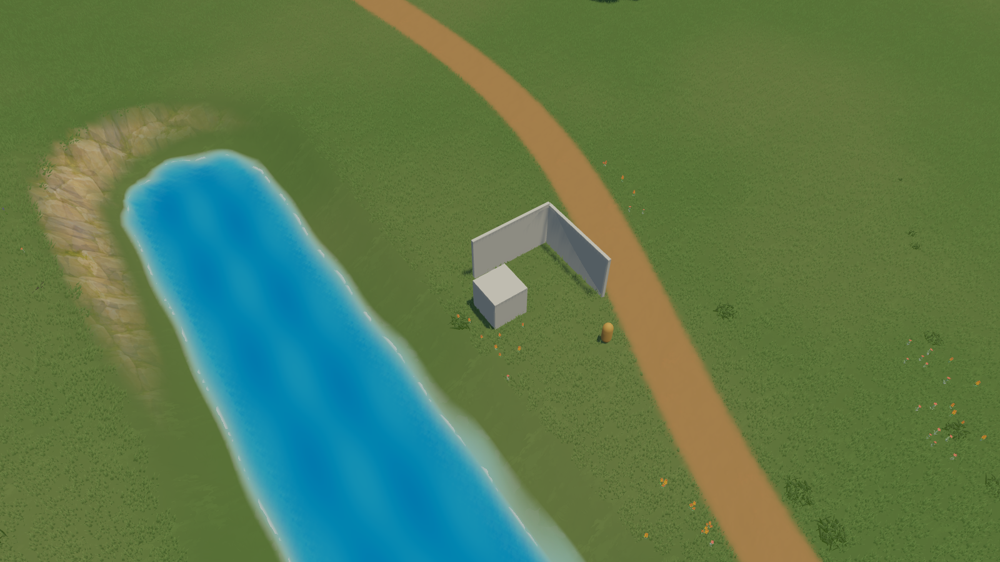
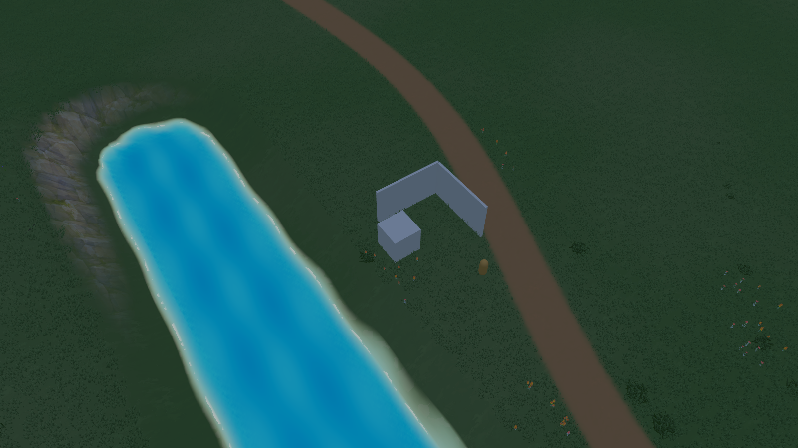

# World Editor: что объединено и как посмотреть

Основной проект — **E:/Games_Develop/Little-Castle**, Unity **6000.5.5f1**,
URP **17.5.0**, Linear. Результат находится здесь, а исходные рабочие копии
сохранены. Дата проверки: 27 октября 2026.

## Что сделано

Окно называется **World Editor**. В нём четыре рабочих раздела:
**Рельеф → Покрытие → Растительность → Реки**. Общие действия сохранения и
Undo/Redo закреплены сверху. Настройки показываются для выбранного инструмента.
Игровая панель Play Mode использует такое же разделение.

Исправлена причина неработающих рек: «Новая река» теперь включает обработку
точек в SceneView. Порядок виден прямо в панели: **новая → минимум две точки →
применить**. Смена раздела сохраняет черновик; сохранение предупреждает о
неприменённых точках. Старые реки v1 читаются без автоматической конвертации,
новые используют водный профиль v2. Существующие скальные участки v1 сохранены.

После перезагрузки скриптов окно восстанавливает карту, настройки и черновик
реки. История отмены после domain reload начинается заново. JSON остаётся
основным способом надёжно сохранить и передать авторский документ.

Свет объединён с актуальными картографическими шейдерами: сохранены дороги,
растительность, ветер, взаимодействие, инстансинг и LOD. Сутки идут непрерывно,
ночь читается; SSAO и тени проверены на трёх расстояниях. Куб и две стены для
проверки освещения оставлены. Экспериментальный spatial GI находится отдельно.

## Что и откуда взято

| Система | Источник | Результат в основном проекте |
|---|---|---|
| Единые кисти, рельеф, поверхности, деревья и рощи | BrushFoundation `4cc6382`, продолжение URP_20261024 | Общий controller, ввод, параметры, региональные обновления, Undo/Redo и savev5; исправленный интерфейс |
| Цветы и мелкая растительность | Актуальные Meadow-каталоги из map/URP | Каталоги и GUID сохранены, заполнена отсутствовавшая библиотека |
| Освещение, SSAO, непрерывные сутки | LightingIntegration `42f317c` и его зависимости | Проверенный Meadow baseline; аккуратное объединение общих шейдеров |
| Вода, течение, отражение, окончания русла | RiverBanks `6a7d58c` | Выборочно перенесены вода и необходимые MIT-зависимости; отдельные water profiles, depth/opaque textures; старые данные поддерживаются |
| Проекция деревьев на рельеф | Сравнение Main и RiverBanks | Явные terrain anchors и деревья каталога; произвольный мост с LODGroup больше не принимается за дерево |
| Генерация, streaming, сохранения, камера, основа стен | Уже существовали в Main | Сохранены, не заменены исследовательским кодом |
| Коттеджи и отдельные локальные модели | Уже находились в Main/asset-библиотеках | Сохранены как имеющиеся наработки; не объявлены завершённым игровым строительством |

Проверены перечисленные в PROJECT_INDEX рабочие копии и различия исходных
веток. Инвентарь до переноса воды находится в
[подробной таблице](world-editor-final-evidence-20261027/inventory-before-water-merge-ru.md).
Её раздел о воде описывает исходное состояние; фактический перенос подтверждён
[отчётом](world-editor-final-evidence-20261027/water-merge-report-ru.md) и
[совместимостью v1](world-editor-final-evidence-20261027/water-legacy-compatibility-addendum.md).
Резервная копия прежнего Main:
`E:/Games_Develop/Research/WorldIntegration_20261027/BeforeMain`.
Не было reset/clean, принудительного переключения веток или удаления старых проектов.

Биомы/динамический снег PR79 остаются экспериментом: аудит выявил семь
воспроизводимых проблем. Полное объединение не выполнялось, как оговорено в
Task02. [Отчёт и обязательная таблица пяти систем](environment-audit-20261027/report-task02-ru.md).
Отклонённая скальная масса RiverBanks и старый CliffKit не перенесены.
Artbook/исходники моделей сохранены отдельно, это не готовые игровые системы.

## Как проверить самому

1. В Unity Hub откройте **E:/Games_Develop/Little-Castle**.
2. Выберите **Little Castle → World Editor → Open Integrated Scene**.
   Сцена: `Assets/_Game/Scenes/WorldEditor_20261027.unity`.
3. Вне Play Mode, во вкладке **Scene**, используйте окно **World Editor** справа.
   Для обычных кистей включите **Рисовать в SceneView**.
4. Для реки: **Реки → Новая река → две точки на земле → Применить реку**.
5. Проверьте дорожку, холм, цветы, дерево/рощу, Undo/Redo, сохранение/открытие JSON.
   Приближайте и отдаляйте камеру.
6. В **Play Mode** слева доступна игровая панель. В **Освещение и камера**
   находятся день/закат/ночь и автоматическая смена суток.

**JSON сохраняет документ окна. «Применить к авторской базе и маске» меняет
стартовый asset карты для Play Mode.** Эти действия имеют разное назначение.
Play Mode использует собственное сохранение сессии. Не путайте документы двух
режимов. [Полная короткая инструкция](../workflows/test-world-editor-ru.md).

Unity оставлена открытой в основном проекте. В окне после ручной проверки
может оставаться демонстрационная река с несохранёнными правками; исходная база
карты этой проверкой не изменялась.

## Что проверено

| Проверка | Результат |
|---|---|
| Все EditMode | **294 PASS / 1 FAIL из 295** |
| Все PlayMode | **16/16 PASS** |
| Новые проверки river workflow / water interoperability / восстановления окна | **8/8, 6/6, 3/3 PASS**, плюс water PlayMode |
| Статическое функциональное слияние шейдеров | **53/53 PASS** |
| Player из Main | **Succeeded, 0 ошибок**; полный build дал 7 предупреждений устаревших Unity API, последующий incremental build — 3 |
| Живые операции дорожки и реки в Player | Создание, Undo/Redo, отдельный disk save/load — PASS |
| Ручная работа окна Unity | Кнопка новой реки, два реальных клика SceneView, Apply, Undo и Redo — PASS |
| Изображение | 40 реальных PNG: день/закат/ночь, 11/35/115 м, SSAO on/off, река днём/ночью; runtime-errors пуст |
| Плавные сутки | 240 последовательных отсчётов, 19:49 → ночь → 06:58, время строго растёт |
| Настройки после build | Три ProjectSettings восстановлены побайтно |

Единственное падение EditMode — прежний
`ConceptNaturalVegetationTests.GroundCoverPresetsRespectClearanceWhileMainTreeFlagsStayLegacy`:
Main preset ожидается с clearance=true, фактически false. Четыре генераторных
preset побайтно совпадают с резервной копией до интеграции. Ради зелёного теста
генерация не менялась.

NOT RUN: полный ручной обход каждого элемента новой Play-панели, длительный
shimmer/motion-тест, нагрузка всего редактора на больших картах и 2/8/16 игроков,
проверка на другом GPU. Ручная GUI-проверка закончена после обнаруженного
пользовательского ввода, чтобы не перехватывать управление. Автотесты Play Mode
и Player не заменяют эти проверки.

## Измерения

RTX 4070 Ti SUPER, DX12, 1600×900, видимое окно, SSAO включён.
Каждый случай: 120 кадров прогрева и 600 обычных кадров без PNG/readback.
Одна тестовая река длиной 36 м, три resident tiles, reflection scale 0.5.
Это небольшой стенд, не замер большой стратегии.

| Ракурс | Медиана кадра, мс | P95, мс | Медиана GPU, мс |
|---|---:|---:|---:|
| Близко, 11 м, река | 1.42 | 2.68 | 0.80 |
| Средне, 35 м, река | 1.85 | 3.12 | 1.12 |
| Далеко, 115 м, река | 1.81 | 3.15 | 0.79 |
| Ночь, 35 м, река | 1.83 | 3.23 | 1.07 |
| Контроль, 35 м, без реки | 1.23 | 2.62 | 0.69 |

GPU timing доступен для 407–444 из 600 кадров, GC recorder недоступен
(это не нулевые аллокации). Применение тестовой реки занимает **277–281 мс**
на основном потоке — заметная разовая пауза. Бюджетируется последующая
визуализация, а не весь commit. Для длинных рек требуется отдельная оптимизация
по измерениям. Дальние тени ограничены baseline 90 м; дальний туман довольно плотный.
Вода ночью остаётся слишком яркой: перенесённый unlit water shader ещё требует
согласования с общей палитрой суток. Это визуальный долг, не готовая приёмка
всех водных материалов.

[Машинная сводка, CSV, XML и подтверждения](world-editor-final-evidence-20261027/summary.json).
Полные логи/Player: `E:/Games_Develop/Research/WorldEditorUsability_20261027`.

Реальные кадры финального Player:

## Как расширять

Новая кисть регистрируется через существующий IMapTool/MapToolRegistry,
использует MapToolContext и общий controller; алгоритм меняет MapEditSession.
Сессия отвечает за данные, Undo/Redo, сохранение и региональные уведомления,
а presentation обновляет затронутые участки. SceneView/Play — отдельные адаптеры
ввода. Runtime не зависит от UnityEditor. Клик и контрольные точки сохраняют
специализированную механику. [Пример существующей кисти](../workflows/add-map-brush-ru.md).

Фундамент пригоден для будущих биомов и игровых операций. Сами карты биомов,
версии их сохранений, снег и правила строительства/стоимость/сеть ещё потребуют
отдельной реализации и проверок. Этапы 2+ автоматически не начинались.

Папка Main и Git-ветка main — разные вещи. Работа выполнена в основной папке
на ветке `codex/world-editor-lighting-integration-20261027`. Draft PR готовится
к исходной ветке этого локального проекта
`codex/concept-world-pass-2026-10-09`; автоматического merge в GitHub main нет.
Публичный source PR не включает сырую лицензируемую библиотеку моделей:
локальные fixtures сохранены, чистому clone нужна их синхронизация.
MIT-лицензии выбранной воды включены в StreamingAssets и Player.
